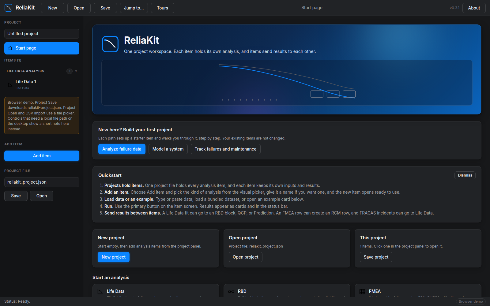

# ReliaKit

Reliability engineering, in one project workspace.



ReliaKit is a reliability engineering suite for engineers who fit life
data, build system reliability models, run FMEA and warranty analyses,
and predict failure rates. Every analysis lives as an item in a single
project file: a Life Data fit, an RBD diagram, an FMEA worksheet, a
Markov model, and fourteen more kinds. Items send results to each
other, so a fit can drive a block diagram, a quick calculation, and a
prediction without retyping. The math is a Rust library with its own
special functions, optimizer, seeded RNG, and Metropolis sampler, so
runs repeat exactly. A command line tool prints the same results as
JSON for scripts.

Try it now:

- Live demo: https://chickenfeetbatman.github.io/reliakit/demo/ runs
  the full workspace in your browser, with the engine compiled to
  WebAssembly. No install, and nothing is uploaded.
- Download v0.3.1: https://github.com/chickenfeetbatman/reliakit/releases/tag/v0.3.1
  has the desktop app and the command line tool for Windows, macOS,
  and Linux.
- User guide: [docs/USER_GUIDE.md](docs/USER_GUIDE.md) covers every
  item kind, the data flows, the Prediction standards, file formats,
  keyboard shortcuts, and platform notes.

## What it does

- Life data analysis for 14 distributions, with censored maximum
  likelihood, rank regression, Fisher matrix bounds, probability
  plots, Kaplan-Meier, and a distribution wizard that ranks candidates
  by AIC, BIC, and Anderson-Darling.
- Limited data methods for small lots: Weibull shape bias correction,
  hierarchical shrinkage, split-conformal bounds, and Bayesian MCMC
  with R-hat and ESS diagnostics.
- Degradation path analysis, accelerated life testing (Arrhenius,
  inverse power law, Eyring, two-stress loglinear, step-stress),
  reliability growth, and competing risks.
- System RBD with series, parallel, k-out-of-n, and standby groups,
  dormancy and switch reliability, CTMC and Monte Carlo availability,
  and reliability importance measures.
- Fault trees with minimal cut sets, and continuous time Markov models
  with steady state, transient, and mean time to absorption results.
- FMEA worksheets (Design, Process, System) with RPN, FMECA
  criticality, DVP&R, and control plan export; an RCM worksheet with
  task selection; and a FRACAS incident log.
- Warranty analysis with Nevada table aggregation and a returns
  forecast.
- Prediction: parts-count and parts-stress, reliability allocation,
  and derating checks. The MIL-HDBK-217F Notice 2 library is built in
  from the public handbook, with the source table recorded per
  category. SR-332 and 62380-style methods run on data you supply.
  Local component libraries import from CSV.
- DOE for two-level factorial and related designs, flowchart process
  simulation, and a QCP quick calculation pad.
- Six data flows between items: a Life Data fit to an RBD block, to
  QCP, and to Prediction; an FMEA row to an RCM row; FRACAS incidents
  to a Life Data item; and the wizard Use action applying a ranked
  distribution to the current fit.
- Sixteen bundled datasets with documented sources, and eight worked
  examples that load from the start page.
- No proprietary data is bundled. Data tables from licensed standards
  are not bundled; you load your own through the local library import.

## Try it in two minutes

```bash
cargo build --release

# Example 1: fit the bearing life data (Weibull), then evaluate it
./target/release/reliakit fit examples/example1_bearing_life.csv --dist weibull2
./target/release/reliakit rel weibull2 1000 beta=2.2168492389077707 eta=4006.6133366126537
#   fitted beta = 2.217, eta = 4006.6 h; R(1000 h) = 0.955; B10 = 1451.8 h

# Example 2: limited data (bias correction, shrinkage, conformal, MCMC)
cargo run --release --example example2_limited_data
#   bias-corrected beta 1.928; conformal lower bound on R(1000) = 0.778;
#   MCMC max R-hat 1.007, min ESS 455

# Example 3: system diagram with a cold standby group
./target/release/reliakit rbd examples/example3_rbd.json --t 1000
#   { "reliability": 0.9214192151709761, "t": 1000.0 }
./target/release/reliakit availability examples/example3_rbd.json --horizon 20000 --sims 200 --seed 3
#   mean availability 0.99630, expected downtime 86.0 h

# Example 4: FMEA worksheet and warranty forecast
./target/release/reliakit fmea examples/example4_fmea.csv
./target/release/reliakit warranty --sales examples/example4_warranty_sales.csv \
    --returns examples/example4_warranty_returns.csv --current 3 --horizon 3

# Example 5: censored ALT maximum likelihood and competing risks
cargo run --release --example example5_alt_and_competing
#   Ea = 0.714 eV recovered (0.7 in generation); competing-risk CIFs printed

./target/release/reliakit selftest     # built-in closed-form checks
./target/release/reliakit-app --headless   # desktop binary smoke check
```

Full outputs: [examples/OUTPUTS.md](examples/OUTPUTS.md). The desktop
app and the browser demo have a start page that loads each example into
its screen, so a downloaded binary runs without data of your own.

## Downloads

- Live demo: https://chickenfeetbatman.github.io/reliakit/demo/
- Release: the [v0.3.1 release](https://github.com/chickenfeetbatman/reliakit/releases/tag/v0.3.1)
  has the desktop app and the CLI for Windows, macOS, and Linux (six
  files). New version tags build new releases the same way.
- From source: clone this repo and run
  `cargo run --release -p reliakit-app` for the desktop app or
  `cargo run --release --bin reliakit` for the CLI. The desktop build
  also needs the Tauri prerequisites for your platform, including the
  WebKitGTK runtime packages on Linux; see the user guide platform
  notes.

## Desktop application and browser demo

One interface, two hosts. The desktop app is a Tauri shell around a
web front end (plain JavaScript modules and hand-written CSS in gui/);
the browser demo serves the same front end with the same engine
compiled to WebAssembly. Project files, screens, and results are
identical between the two. In the demo, project Save downloads
reliakit-project.json, project Open and CSV import use a file picker,
and controls that need a local file path on the desktop show a short
note with a working picker or download instead.

The workspace is a start page with a first project wizard card,
Start an analysis cards, and example and dataset cards, a project
source list in the sidebar grouped by family, the plot, diagram, or
table in the center, and an inspector with headline result cards on
the right. Add item opens a visual picker of all 18 kinds grouped by
family, Ctrl+K (Cmd+K on macOS) opens a quick switcher, and guided
tours for every kind run from the toolbar Tours list. Item
kinds: Life Data (CSV load, fit, reliability curve and probability
plot), Limited Data, MCMC, Degradation, ALT, Growth, Competing Risks,
System RBD, Fault Tree, FMEA, Warranty, Prediction, DOE, Flowchart,
Markov, QCP, RCM, and FRACAS. Each item keeps its own inputs and
results. One JSON project file saves and loads the whole project in
the reliakit-project-2 format. The design system is documented in
docs/DESIGN.md, and the full manual is docs/USER_GUIDE.md.

On the System RBD screen you arm a palette item (single block, standby
group, parallel group, k-out-of-n group), click the canvas to place
it, drag blocks to move them, and click a block to select it and edit
its properties in the inspector. Each block carries a name,
distribution, parameters, MTBF/MTTR, and a mode (active, hot standby,
cold standby, warm with dormancy). The topology evaluates as you edit,
availability is computed on the same screen, and diagrams save and
load as the JSON the library and CLI accept. Keyboard shortcuts:
Ctrl+S saves the project, Ctrl+O opens one, Ctrl+K opens the quick
switcher, and Delete removes the selected RBD block or table row. `reliakit-app --headless` runs a
no-window check: it builds the Example 3 diagram and prints its
reliability and availability.

Attribution: the desktop shell is built with
[Tauri](https://tauri.app), used under the MIT and Apache-2.0
licenses. Inter, the bundled user interface font, is licensed under
the SIL Open Font License 1.1 (see gui/assets/OFL.txt in the app
bundle and gui/ui/fonts/OFL.txt in this repository).

## Command line

`reliakit` prints JSON results for: `fit`, `rel`, `rbd`,
`availability`, `growth`, `af`, `alt-mle`, `competing`, `standby`,
`flow`, `fmea`, `warranty`, `faulttree`, `predict`, `doe`,
`wizard`, `qcp`, `importance`, `markov`, `predict217`, `sr332`,
`mission`, `allocate`, `library`, `fracas`, `degradation`, and
`selftest`. `reliakit <command> --help` shows the arguments.

## ReliaSoft parity matrix

Implemented means tested code. Limited means the limit is stated
in the row.

| ReliaSoft area | Rust implementation | Status |
| --- | --- | --- |
| Weibull++ life data: 14 distributions (weibull2, weibull3, weibull1, lognormal, normal, exponential, exponential2, gamma, gumbel, loglogistic, logistic, gompertz, gengamma, mixed_weibull) | `distributions` | Implemented (mixed_weibull has 2 subpopulations) |
| Censored (suspended) MLE, Fisher matrix bounds | `distributions` | Implemented |
| Median rank regression, probability plots, Kaplan-Meier | `distributions` | Implemented |
| Distribution wizard (best-fit ranking by AIC, with BIC and Anderson-Darling) | `wizard` | Implemented (weibull1 is not a wizard candidate; its shape is fixed by the user) |
| QCP (quick calculation pad: reliability, unreliability, hazard, mean life, pdf, Bx life at one mission time) | `quickcalc` | Implemented |
| Limited data: Weibull shape bias correction | `bayes` | Implemented |
| Limited data: hierarchical empirical-Bayes shrinkage (DerSimonian-Laird) | `bayes` | Implemented |
| Limited data: split-conformal certified mission time and reliability bound | `bayes` | Implemented |
| Bayesian MCMC with R-hat / ESS diagnostics, hierarchical model | `mcmc` | Implemented |
| Degradation analysis (linear, exponential, power paths) | `degradation` | Implemented |
| ALTA: Arrhenius, inverse power law, Eyring (least squares) | `alt` | Implemented |
| ALTA: censored maximum-likelihood fitting, all three models, use-level extrapolation with bounds | `alt` (`fit_alt_mle`) | Implemented |
| ALTA: two-stress Eyring with interaction term | `alt` (LSQ and MLE) | Implemented |
| ALTA: loglinear multi-stress MLE (generalized Eyring form) | `alt` (`fit_alt_mle_loglinear`) | Implemented for exactly two stresses (temperature and one nonthermal stress, weibull2 and lognormal lives); up to 8 stresses and user transforms are not built |
| ALTA: step-stress profiles | `alt` (step-stress reliability and CDF) | Implemented for step profiles; general time-varying stress entry is not built |
| RGA: Crow-AMSAA and Duane growth models | `growth` | Implemented |
| RGA: Gompertz and Lloyd-Lipow growth models | `growth` | Implemented (one Gompertz fit; no separate modified Gompertz form) |
| BlockSim: series, parallel, k-out-of-n, nested RBD from JSON | `system` | Implemented |
| BlockSim: standby redundancy, dormancy (cold / warm / hot), switch reliability | `system`, `standby` | Implemented |
| Standby groups of any size: exact exponential closed form, general distributions by recursive convolution quadrature, Monte Carlo cross-check | `standby` | Implemented (quadrature is practical to about 5 units; larger groups fall back to Monte Carlo) |
| BlockSim: CTMC steady-state and transient availability, Monte Carlo availability with swap-time downtime | `system` | Implemented |
| BlockSim: posterior system reliability propagation | `system` | Implemented |
| BlockSim: Markov diagrams (steady state, transient, mean time to absorption) | `markov` | Implemented |
| BlockSim: reliability importance (Birnbaum, criticality, Fussell-Vesely) | `importance` | Implemented (measures only; no importance plots) |
| Reliability allocation (target reliability split across blocks or parts) | `prediction` (`allocate_equal`, `allocate_weighted`) | Implemented for equal and weighted allocation; cost optimized, AGREE, Feasibility of Objectives, ARINC and Repairable Systems allocation are not built |
| FTA: AND / OR / voting gates, top-event probability, minimal cut sets | `faulttree` | Implemented (cut sets are exact for small trees; no binary decision diagram engine) |
| Competing risks / failure-mode analysis, cause-specific cumulative incidence | `competing` | Implemented (independent risks; a failure with unknown mode is treated as its own "unknown" mode category) |
| XFMEA: worksheet with severity, occurrence, detection, RPN, actions, revised RPN, CSV import/export | `fmea` | Implemented |
| XFMEA: FMEA types (Design, Process, System), FMECA criticality, control plan export, DVP&R table | `fmea`, `rcm` | Implemented (control plan export has rows with recommended actions; DVP&R has CSV round trip) |
| RCM++: RCM worksheet (consequence classes, task selection, mode criticality) | `rcm` | Implemented |
| XFRACAS: incident log (part, failure mode, hours, date, status, corrective action; counts and MTBF; CSV round trip) | `fracas` | Implemented as a local log; the hosted web portal and multi-user workflow are out of scope |
| Warranty: Nevada-table aggregation, Weibull fit to returns, forecast for units in service | `warranty` | Implemented |
| Lambda Predict style prediction: parts-count and parts-stress framework, user-entered base rates and stress / quality / environment factors, series roll-up | `prediction` | Implemented |
| Standards based prediction (MIL-HDBK-217F, SR-332, IEC 62380) | `standards217`, `prediction` | MIL-HDBK-217F Notice 2 library built from the published handbook PDF: 18 part categories with per-table provenance (sections listed in FEATURE_RESEARCH.md). Sections 5 and 6 are not included because the Notice 2 document carries only replacement pages for them. NSWC not included. SR-332 and IEC 62380: methods implemented clean-room from public secondary sources; the standards own data tables are licensed documents and load through the local library import. No table data from those standards is bundled. |
| Derating check (operating stress against rated stress, user limit) | `prediction` (`derating_check`) | Implemented; built-in derating standards tables are not bundled |
| Component library file format with local import (library CSV of parts and rates) | `prediction` (`library_from_csv`) | Implemented; ReliaSoft compiled libraries are not used |
| DOE++: two-level factorial designs, effect estimates, sums of squares | `doe` | Implemented for 2^k designs (main effects and interactions) |
| DOE++ expansion: fractional factorial, Plackett-Burman, Taguchi arrays, response surface (central composite, Box-Behnken, quadratic fit) | `doe` | Implemented |
| RENO style flowchart simulation: start, task, decision, loop/counter, end blocks, Monte Carlo run-time and cost distributions | `flowchart` | Implemented (JSON-defined flows; no graphical flow editor) |
| Bundled datasets: 16 sourced CSV files with CSV import, plus synthetic example data generators | `datasets/`, `datasets` | Implemented (sources and verification fits are in FEATURE_RESEARCH.md) |
| GUI project file (save and load app state, ReliaKit own JSON format) | `reliakit-app` | Implemented; ReliaSoft project formats are not read |
| Project workspace (Synthesis-style project and item organization, data flows between items) | `reliakit-app` | Implemented; one project open at a time, no multi-user database, no cloud sync |
| ReliaSoft Cloud | none | Out of scope: hosted service, not desktop software |
| MPC / MSG-3 | none | Out of scope: aerospace program tooling |

Each implemented row has at least one test with a known or
cross-checked value. FEATURE_TEST_LEDGER.md lists them feature by
feature.

## Tests

```bash
cargo test
```

167 integration tests in 13 files, all passing, plus the CLI self
test:

| Test file | Tests |
| --- | --- |
| tests/ported_tests.rs (the Python suite's 31 tests, ported) | 30 |
| tests/parity_tests.rs (FMEA, warranty, fault tree, prediction, DOE) | 7 |
| tests/qa_tests.rs (independent cross-checks) | 13 |
| tests/coverage_tests.rs (lognormal, normal, power path, IPL fit) | 4 |
| tests/alt_mle_tests.rs | 4 |
| tests/competing_tests.rs | 4 |
| tests/standby_tests.rs | 6 |
| tests/flowchart_tests.rs | 5 |
| tests/dist_tests.rs (v0.2.0 distributions) | 20 |
| tests/hbk_tests.rs (Markov, allocation, derating, library, RCM, FRACAS, FMEA additions, SR-332 and 62380 style methods) | 29 |
| tests/expansion_tests.rs (wizard, QCP, importance, DOE expansion, Gompertz, Lloyd-Lipow, loglinear ALT, step-stress) | 18 |
| tests/datasets_tests.rs (bundled dataset sums and fit verification) | 19 |
| tests/standards217_tests.rs (MIL-HDBK-217F Notice 2 library) | 8 |

The Python suite has 31 tests. The ported file groups the same
assertions, with the same known values and tolerances, into 30
test functions.

## Benchmarks

Same workloads, same parameters, same machine. Python numbers come
from the original suite; the script is in `bench/`.

| Workload | Python | Rust | Speedup |
| --- | --- | --- | --- |
| Monte Carlo availability, 300 runs, horizon 20000 h | 0.033 s | 0.002 s | about 16x |
| MCMC, 4 chains x (2000 warmup + 2000 draws), 60 points | 0.402 s | 0.031 s | about 13x |
| Conformal coverage study, 200 replicates | 2.663 s | 0.049 s | about 54x |

Coverage in the study: Python 192/200, Rust 191/200 at nominal
90 percent. Run the Rust side with
`cargo run --release --bin reliakit-bench`.

## Crate layout

```
src/
  lib.rs            module map and crate docs
  specfunc.rs       gamma / beta / normal special functions
  rng.rs            xoshiro256** RNG, seedable, distribution samplers
  optim.rs          Nelder-Mead, golden section, linear algebra, least squares
  distributions.rs  life distributions, MLE, rank regression, bounds, Kaplan-Meier
  bayes.rs          bias correction, shrinkage, hierarchical EB, conformal bounds
  mcmc.rs           adaptive Metropolis-Hastings, R-hat, ESS
  degradation.rs    degradation paths and pseudo-failure times
  alt.rs            accelerated life testing (LSQ, censored MLE, loglinear, step-stress)
  growth.rs         Crow-AMSAA, Duane, Gompertz, Lloyd-Lipow
  competing.rs      competing risks and cumulative incidence
  system.rs         RBD evaluation, standby, CTMC, availability simulation
  standby.rs        n-unit standby by recursive convolution quadrature
  flowchart.rs      flowchart (process network) simulation
  faulttree.rs      fault trees and minimal cut sets
  fmea.rs           FMEA worksheet, types, FMECA, control plan, DVP&R, CSV
  warranty.rs       Nevada table and returns forecast
  prediction.rs     parts-count / parts-stress prediction framework, allocation, derating, component library, SR-332 and 62380 style methods
  doe.rs            factorial designs and effects, fractional, Plackett-Burman, Taguchi, response surface
  wizard.rs         distribution wizard (best-fit ranking)
  quickcalc.rs      QCP (quick calculation pad)
  importance.rs     reliability importance measures
  markov.rs         Markov diagrams (CTMC models with named states)
  rcm.rs            RCM worksheet and mode criticality
  fracas.rs         FRACAS incident log
  standards217.rs   MIL-HDBK-217F Notice 2 part stress models
  datasets.rs       synthetic example data generators (labelled synthetic)
  bin/reliakit.rs       CLI
  bin/reliakit_bench.rs benchmarks
gui/                desktop app crate (Tauri shell, web front end in gui/src and gui/styles, WASM demo build), binary reliakit-app
examples/           worked examples with captured outputs (OUTPUTS.md)
datasets/           16 bundled sourced CSV datasets (see FEATURE_RESEARCH.md)
libraries/mil217/   MIL-HDBK-217F Notice 2 library, one JSON file per category
bench/              the Python benchmark script used above
tests/              the test files listed above
```

The library depends on serde, serde_json, and clap. The desktop
app crate adds the Tauri shell; the front end is plain JavaScript and
CSS with no bundler, and charts are drawn as inline SVG by the front
end from the series the engine returns. The RNG is the crate's own
seeded xoshiro256**.

Interface history: v0.3.0 replaced the GUI toolkit with the Tauri and
web front end above; earlier releases used other toolkits.

## Toolchain

Built with rustc 1.99.1 and cargo 1.99.1, installed from the
official rustup script on Ubuntu 24.04. CI runs
`cargo test --workspace` on Linux. The release workflow builds
Windows, macOS, and Linux binaries on version tags.

## License

MIT. See LICENSE.
